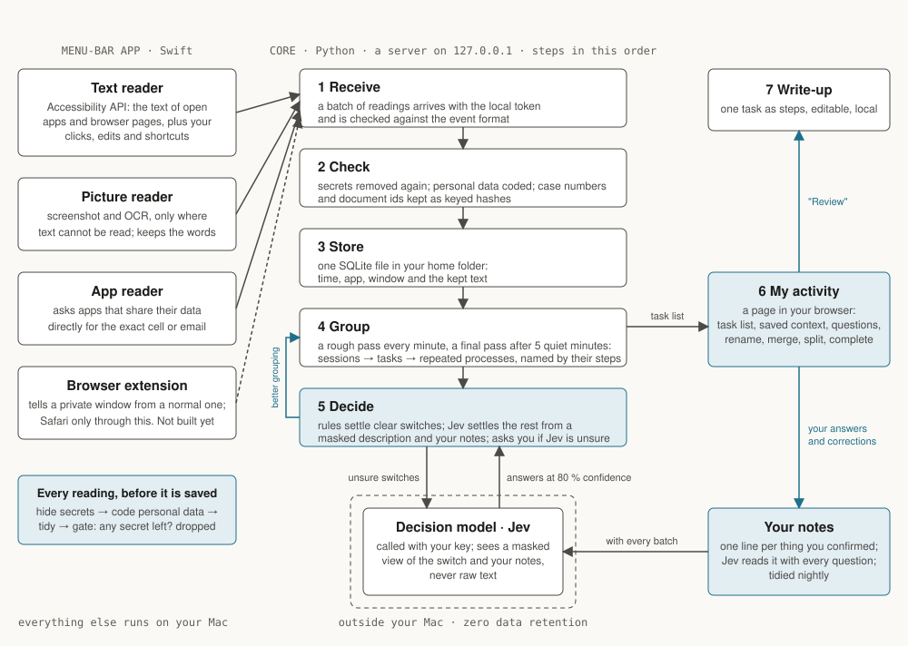
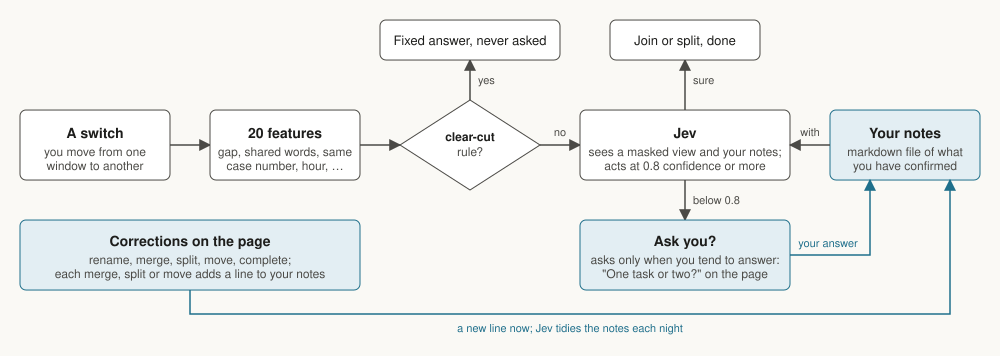

# taskmine

**Status (20 Oct):** core and menu-bar app ported from Veyfold; browser extension not built yet.

Taskmine turns what you do on your Mac into a list of the tasks you worked on, with the steps for each, and learns from your corrections.

## Background

Taskmine is the single-Mac core of Veyfold, a product for enterprise operations teams. Veyfold watched how work was done across a company, turned it into process documents, and kept them current. This repository is a rebuild of that core from the Veyfold design, written to be read and run on its own. It has the reader, the grouping, the decision models and the review page. The company-wide parts are left out: shared knowledge, team review, integrations.

## Problem

To improve or automate a process you need to know how it is done: the steps, the apps, how often, where it varies. Current task miners get this from recorded sessions. The employee starts a recording, consents to it, and an analyst labels it afterwards. Little gets recorded, the recordings cover the easy cases, and the documents are stale by the time they are read.

## Solution

Record all the time, and let models do the labelling. Taskmine reads the screen through the Accessibility API, removes secrets and personal data before saving, and groups the readings into tasks and repeated processes. Rules settle the clear switches. A decision model settles the rest from a masked description and your notes. A person is asked only when it is unsure, and each answer becomes a line in the notes.

## How it works



A menu-bar app reads the window you are using through four readers.

- **Text reader.** The Accessibility API: window text, clicks, edits, shortcuts. Most apps, and Chrome, Edge, Brave, Arc and Firefox pages.
- **Picture reader.** For apps that draw their text, such as a Google Sheet. A screenshot of the page area, OCR, the image discarded.
- **App reader.** For apps that share their data, such as a spreadsheet's cells or an email. The exact values instead of the screen.
- **Browser extension.** Not built yet. It will tell a private window from a normal one, so it is the path that will read Safari.

Before a reading is saved, secrets are removed and personal data such as card and bank numbers are replaced by codes.

The core receives the readings, stores them in one SQLite file, and groups them: sessions in one window, then stretches of work on one thing, then repeated processes.

The **My activity** page shows the tasks. You rename, merge, split or complete them. Taskmine learns from each change.

## Install

macOS 14 or later, Python 3.12 or later, the Xcode command line tools, and a decision-model key.

```sh
git clone https://github.com/finlaycrasnier/taskmine.git && cd taskmine
make setup     # Python environment, Swift build, .env from .env.example
```

Put your key in `.env` as `TASKMINE_MODEL_KEY`, then:

```sh
make run       # starts the core and the menu-bar app, opens My activity
```

Grant Accessibility when the menu bar asks. Choose **Record my activity**.

## How it learns



Each switch between windows is one decision: same task, or a new one.

1. **Rules** decide the clear cases. Ten idle minutes: new task. A new case number in the title: new task. Copy in one window, paste in the next: same task.
2. **The decision model** decides the rest. Jev by default. It sees a masked description of the switch and your notes. Its answer counts at 80 % confidence or more.
3. **Your notes** are a file on your Mac, `~/.taskmine/notes.md`. Each answer, merge, split or move adds one line, such as "Preview to Excel is usually one task". The lines hold app names only. Jev tidies the file each night. You can open and read it.

When the model is unsure, the page asks "One task or two?". At most three questions are open at a time.

Whether to ask is learned by reinforcement. Taskmine is rewarded when you answer and penalised when you dismiss, per kind of situation, so it learns when a question is worth asking.

## Privacy

- Readings stay in `~/.taskmine` and are deleted after thirty days.
- Passwords, keys and tokens are removed before saving. Card numbers, bank accounts, emails and phone numbers are replaced by codes.
- Never read: password fields, private browsing, password managers, login dialogs, terminals, banking sites, sign-in pages. Safari is not read yet: without an extension the app cannot tell a private window from a normal one, so it fails closed.
- No keystrokes. No screenshots kept.
- The decision model receives a masked description of unsure switches, not your saved text.
- Your notes hold app names and your answers, no window text, and stay on your Mac except as part of the masked questions sent to the decision model.

## Read more

- [docs/ARCHITECTURE.md](docs/ARCHITECTURE.md)
- [docs/LEARNING.md](docs/LEARNING.md)
- [docs/CONTRACTS.md](docs/CONTRACTS.md)

MIT licence.
