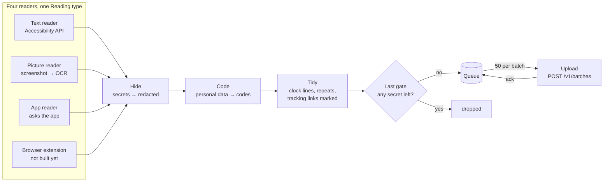
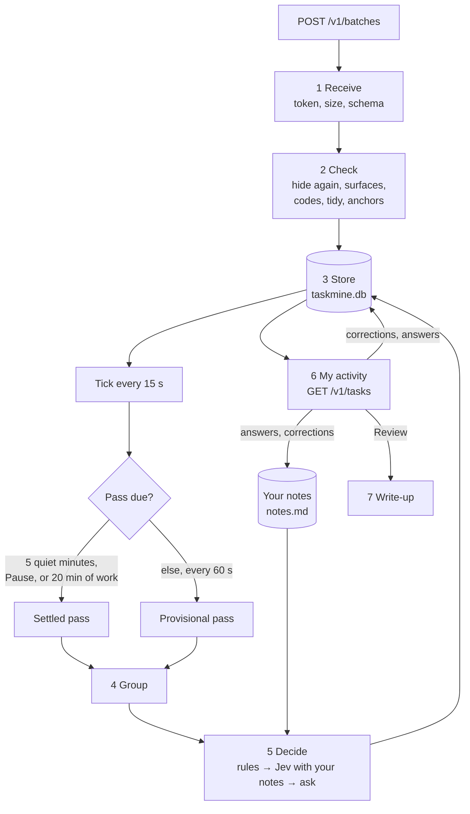
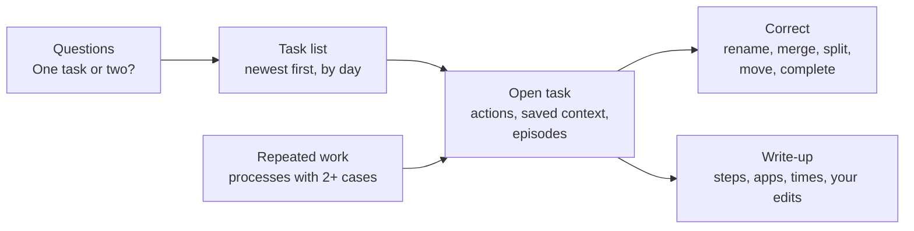

# Architecture

## Menu-bar app

- **Trigger.** Accessibility notifications on the frontmost app (focus, window, title, value), debounced 0.5 s for structure and 2 s for typing, plus a 3 s poll. An unchanged window is not re-read; its sighting count grows.
- **Text reader.** Walks the accessibility tree in reading order: 500 nodes and 0.75 s for a native window, 3,000 nodes for a web page. A roles-only privacy inspection runs first; one secure field blocks the window. Spreadsheet cells come out as `A2: value | B2: value`. Menus and toolbars are counted, not kept. Clicks, edits and shortcuts are separate readings. An edit burst is one reading with a count; the final field value is read once when the burst ends.
- **Picture reader.** Runs when a window that passed every check shows little text. Captures the page area, recognises lines with Vision, orders them, releases the image. The checks run again after recognition; any change discards the result.
- **App reader.** A registry keyed by bundle id. An entry asks the app for its data and returns a Reading.
- **Browser extension.** It will tell a private window from a normal one, so Safari can be read. It is not built yet.
- **Queue.** One table in `~/.taskmine/reader.db`: pending, acked or quarantined. A rejected reading is quarantined on the Mac and never resent. A `credential_detected` rejection keeps a stub without its payload; other rejections keep the payload so a fault can be inspected. Acked and quarantined rows are pruned after 30 days.
- **Policy.** Fetched from the core every 3 s: active or paused, allowed apps, excluded domains, retention. Pause stops the readers at once. The last policy holds for 30 s after the core stops answering; then capture fails closed.

## Core

- **Receive.** Loopback only, bearer token from `~/.taskmine/token`, 2 MB cap, every event validated against the schema. The ack names every event: stored, duplicate, stale, or rejected with a reason.
- **Check.** The hide and code rules run again. Anchors are extracted: case numbers from titles and focused elements, document ids, window ids, stored as keyed hashes under `~/.taskmine/anchor.key`.
- **Store.** One SQLite file, twelve tables. See [CONTRACTS.md](CONTRACTS.md).
- **Group.** Sessions: one stretch in one app on one surface, closed after 120 s idle. Episodes: sessions joined by the decisions in [LEARNING.md](LEARNING.md); a short diversion can resume the earlier work. Tasks: episodes joined by shared case numbers or documents. Processes: episodes with the same step sequence for different cases, matched by sequence similarity; the variable part of their titles becomes a template such as `Onboarding - {name}`. Names: `Verb object in System` from fixed lists, so a name never holds a person's name or an amount.
- **Decide.** Rules settle the clear switches. The switches a settled pass leaves go to Jev in one request: a masked view of each switch, with your notes. An answer applies at confidence 0.8 or more. Below that, the asker decides whether to ask you. See [LEARNING.md](LEARNING.md).
- **Notes.** One line per confirmed pattern, app names only. Jev tidies the file each night between 01:00 and 05:00 and keeps it under 200 lines.
- **Provisional and settled.** The same code runs every minute on unplaced readings and again after five quiet minutes. The settled pass closes episodes, names tasks, matches processes, chooses questions. Learning acts on settled passes only.
- **Retention.** Readings older than thirty days are deleted every minute. Labels, ask stats and the notes file hold no captured text and are kept.

## Page

Served by the core at `http://127.0.0.1:8797/`. Polls every 15 s. Every correction carries the task's revision; a stale one gets 409 and the page reloads. Loopback requests only; foreign origins are rejected.

## Files

| Path | Holds | Mode |
|---|---|---|
| `~/.taskmine/taskmine.db` | readings, tasks, decisions, labels | 0600 |
| `~/.taskmine/reader.db` | the upload queue | 0600 |
| `~/.taskmine/token` | the upload token, made by the core | 0600 |
| `~/.taskmine/coding.key` | the key behind personal-data codes, made by the app | 0600 |
| `~/.taskmine/anchor.key` | the key behind anchor hashes, made by the core | 0600 |
| `~/.taskmine/notes.md` | your notes, made by the core, read by Jev | 0600 |
| `~/.taskmine/policy.json` | active or paused, allowed apps, retention | 0600 |
| `.env` | port, home, retention, model key, call alert | |
