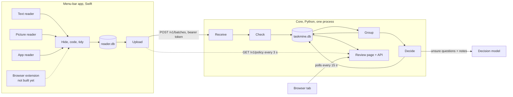
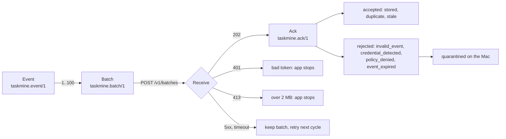
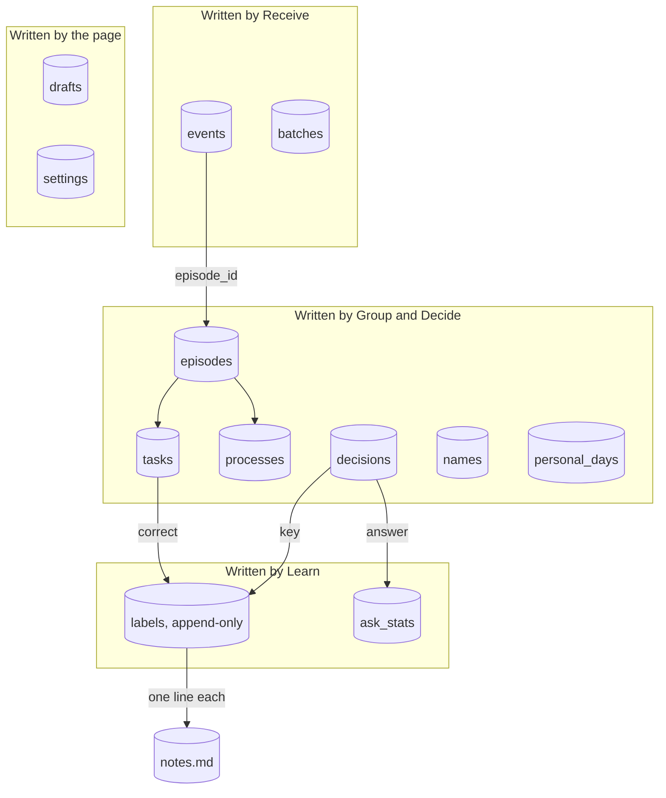
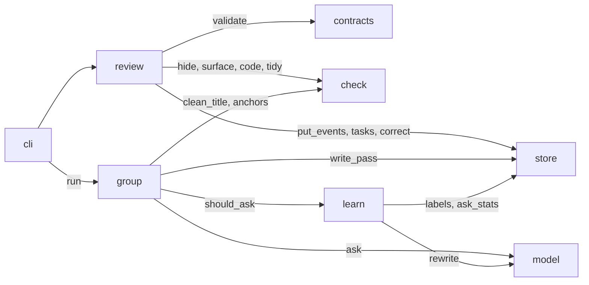
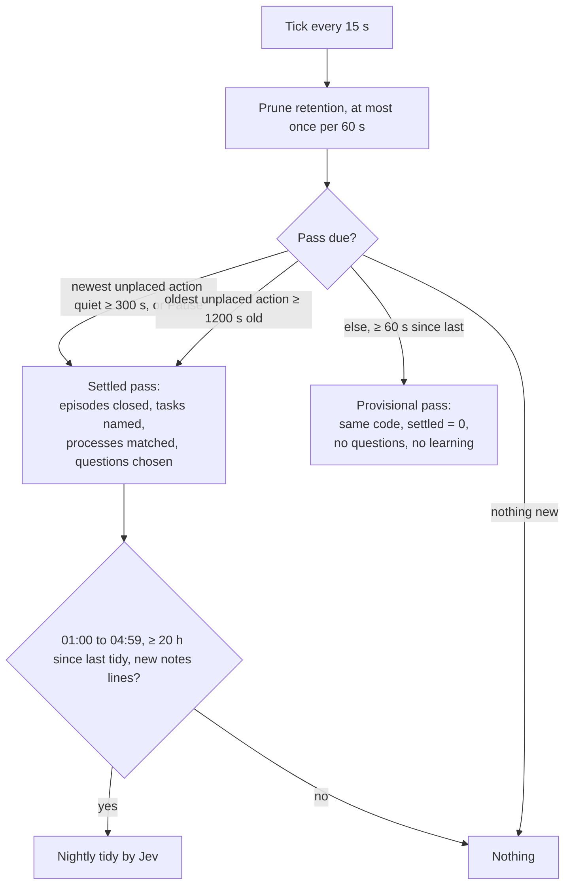

# Contracts

## 1. Parts and boundaries



```sh
# .env.example
TASKMINE_HOME=~/.taskmine        # database, token, key, policy
TASKMINE_PORT=8797               # loopback only
TASKMINE_RETENTION_DAYS=30
TASKMINE_LOG=info

TASKMINE_MODEL_URL=https://ai-gateway.vercel.sh/typesafe/v1/systemone
TASKMINE_MODEL_NAME=typesafe-ai/jev
TASKMINE_MODEL_KEY=              # required; the core does not start without it
# Any OpenAI-compatible decision model works. Jev is the default.
TASKMINE_MODEL_CALLS_ALERT=120   # a daily alert, not a cap
```

## 2. Wire contract



```jsonc
{
  "schema": "taskmine.event/1",
  "event_id": "desktop-6f1c…",           // ^[A-Za-z0-9][A-Za-z0-9._:-]{0,127}$
  "revision": 1,                          // grows by 1; text changes only via text_revision
  "source_id": "mac-a1b2c3",
  "observed_at":   "2026-10-20T09:00:00Z",   // first_seen_at <= observed_at <= last_seen_at, UTC
  "first_seen_at": "2026-10-20T09:00:00Z",
  "last_seen_at":  "2026-10-20T09:00:30Z",
  "provenance": "native_accessibility",   // | native_interaction | screen_ocr | app_reader | synthetic
  "content": {
    "type": "screen_text",                // | interaction | capture_gap
    "text": "…",                          // <= 60 000 scalars, already hidden and tidied
    "text_sha256": "…",
    "metadata": { "app_bundle_id": "com.apple.TextEdit", "app_name": "TextEdit",
                  "window_title": "Onboarding - Northwind", "window_ref": "window:<uuid>" }
  }
}
```

| Metadata key | Set on | Rule |
|---|---|---|
| `app_bundle_id`, `app_name` | all | required; the bundle id is the key everywhere |
| `window_title`, `window_ref`, `document_id`, `browser_domain` | screen_text, interaction | title hidden and coded; `window:<uuid>`; `document:<64 hex>`; host only, never a path |
| `interaction_type`, `trigger`, `control_role`, `focus_name`, `focus_path`, `element_id`, `shortcut` | interaction | `interaction_type` required |
| `sighting_count`, `duration_s`, `text_revision`, `value_omitted` | revisions | the only fields a later revision may change, plus text and hash |
| `gap_reason`, `capture_method` | capture_gap | `withheld:<category>`; no title, ref or domain |
| `codes`, `furniture`, `ocr_confidence`, `ocr_reason`, `private_browsing`, `case_ref` | optional | |

**Batch** `{schema, batch_id, source_id, events[1..100]}`, at most 1.5 MB. **Ack** `{schema, batch_id, accepted[], rejected[]}`; it must name every event once or the app treats it as a failure. **Policy** `{schema: "taskmine.policy/1", version, state: active|paused, allowed_apps, excluded_domains, allowed_provenance, retention_days}`. Headers: `Authorization: Bearer <token>`, `X-Taskmine-Reader: <version>/<sanitizer version>`; an unsupported sanitizer version gets 426.

## 3. Core database



```sql
CREATE TABLE events (
  event_id      TEXT PRIMARY KEY,
  revision      INTEGER NOT NULL,
  provenance    TEXT NOT NULL,        -- native_accessibility | native_interaction | screen_ocr | app_reader | synthetic
  kind          TEXT NOT NULL,        -- screen_text | interaction | capture_gap
  observed_at   TEXT NOT NULL,        -- UTC ISO 8601 Z, as every time column
  first_seen_at TEXT NOT NULL,
  last_seen_at  TEXT NOT NULL,
  app           TEXT NOT NULL,        -- bundle id
  app_name      TEXT,
  title         TEXT,                 -- as received; cleaned on read
  url           TEXT,                 -- scheme + host + path
  document_id   TEXT,
  window_ref    TEXT,
  interaction   TEXT,                 -- click | edit | shortcut | scroll | focus | window_focus | navigation | NULL
  text          TEXT NOT NULL DEFAULT '',
  metadata      TEXT NOT NULL,        -- JSON, the remaining keys
  sightings     INTEGER NOT NULL DEFAULT 1,
  duration_s    INTEGER NOT NULL DEFAULT 0,
  case_keys     TEXT NOT NULL DEFAULT '[]',   -- JSON [[namespace, value]], hashed
  artifact_key  TEXT, surface_key TEXT, window_key TEXT,
  episode_id    TEXT,                 -- NULL until a pass places it
  received_at   TEXT NOT NULL
);
CREATE INDEX events_at ON events(observed_at);
CREATE INDEX events_episode ON events(episode_id);

CREATE TABLE episodes (               -- a run of sessions that is one piece of work
  id              TEXT PRIMARY KEY,   -- sha256 of the sorted action ids, 32 hex: a rerun writes the same row
  task_id         TEXT NOT NULL,
  started_at      TEXT NOT NULL, ended_at TEXT NOT NULL,
  first_action_at TEXT NOT NULL, last_action_at TEXT NOT NULL,
  close_reason    TEXT,               -- idle | break | diversion | quiet | paused | NULL while open
  settled         INTEGER NOT NULL DEFAULT 0,   -- 0 provisional, 1 closed by a quiet or forced pass
  trivial         INTEGER NOT NULL DEFAULT 0,
  diversion       INTEGER NOT NULL DEFAULT 0,
  signature       TEXT NOT NULL,      -- JSON {steps:[{kind, app, evidence[]}], apps[], artifacts[]}
  process_id      TEXT,
  revision        INTEGER NOT NULL DEFAULT 1
);

CREATE TABLE tasks (                  -- one row on the page
  id                TEXT PRIMARY KEY, -- hash of the earliest action id; survives merges
  title             TEXT,
  name_basis        TEXT NOT NULL DEFAULT 'rules',   -- rules | model | person
  summary           TEXT,
  lifecycle         TEXT NOT NULL DEFAULT 'active',  -- active | completed | abandoned
  locked            INTEGER NOT NULL DEFAULT 0,      -- set by any correction
  possibly_personal INTEGER NOT NULL DEFAULT 0,
  revision          INTEGER NOT NULL DEFAULT 1,      -- corrections send expected_revision; mismatch = 409
  started_at        TEXT NOT NULL, last_seen_at TEXT NOT NULL,
  case_keys         TEXT NOT NULL DEFAULT '[]',
  draft_id          TEXT
);

CREATE TABLE decisions (              -- one per switch between two sessions
  key             TEXT PRIMARY KEY,   -- hash(first action id of previous session, first action id of next)
  left_event_id   TEXT NOT NULL, right_event_id TEXT NOT NULL,
  at              TEXT NOT NULL,
  features        TEXT NOT NULL,      -- JSON {name: number}
  model_confidence REAL,              -- Jev's reported confidence; NULL when there was none
  choice          TEXT NOT NULL,      -- same | supporting | break | diversion
  basis           TEXT NOT NULL,      -- rule | model | person
  reason          TEXT NOT NULL,
  hard            INTEGER NOT NULL,
  asked_at TEXT, ask_context TEXT, question_status TEXT,   -- open | answered | snoozed | dismissed | expired
  answer TEXT, answered_at TEXT
);

CREATE TABLE labels (                 -- append only; the current label is the newest row per key
  id       INTEGER PRIMARY KEY,
  at       TEXT NOT NULL,
  kind     TEXT NOT NULL,             -- relation | match | name | complete
  key      TEXT NOT NULL,
  source   TEXT NOT NULL,             -- answer | correction | scripted
  label    TEXT NOT NULL,
  features TEXT                       -- JSON copy of decisions.features at label time
);

CREATE TABLE processes (id TEXT PRIMARY KEY, name TEXT, signature TEXT NOT NULL, steps TEXT NOT NULL,
  templates TEXT NOT NULL, score REAL NOT NULL, basis TEXT NOT NULL,   -- rules | model | person
  created_at TEXT NOT NULL, updated_at TEXT NOT NULL);
CREATE TABLE names (signature TEXT PRIMARY KEY, verb TEXT, object TEXT, system TEXT, title TEXT,
  basis TEXT NOT NULL, reusable INTEGER NOT NULL DEFAULT 0, updated_at TEXT NOT NULL);
CREATE TABLE ask_stats (context TEXT PRIMARY KEY, alpha REAL NOT NULL, beta REAL NOT NULL,
  asks INTEGER NOT NULL, updated_at TEXT NOT NULL);
CREATE TABLE drafts (id TEXT PRIMARY KEY, task_id TEXT NOT NULL, task_revision INTEGER NOT NULL,
  status TEXT NOT NULL, workflow TEXT NOT NULL, created_at TEXT NOT NULL, updated_at TEXT NOT NULL);
CREATE TABLE personal_days (day TEXT PRIMARY KEY, tasks INTEGER NOT NULL, minutes INTEGER NOT NULL);
CREATE TABLE batches (batch_id TEXT PRIMARY KEY, received_at TEXT NOT NULL, ack TEXT NOT NULL);
CREATE TABLE settings (key TEXT PRIMARY KEY, value TEXT NOT NULL);
```

Retention: every 60 s events older than `TASKMINE_RETENTION_DAYS` are deleted, then episodes with no events, then tasks with no episodes. Labels, ask stats and the notes file hold no captured text and are kept.

**Reader queue** (`reader.db`):

```sql
CREATE TABLE queue (sequence INTEGER PRIMARY KEY AUTOINCREMENT, event_id TEXT NOT NULL, revision INTEGER NOT NULL,
  payload TEXT NOT NULL, state TEXT NOT NULL DEFAULT 'pending',   -- pending | acked | quarantined
  code TEXT, reason TEXT, created_at TEXT NOT NULL, UNIQUE(event_id, revision));
CREATE TABLE settings (key TEXT PRIMARY KEY, value TEXT NOT NULL);
```

A batch is the newest pending revision of each event, oldest first, 50 at a time. `batch_id` derives from the member ids; a retry resends the same batch.

## 4. Module interfaces



| Module | Interface | Proven by |
|---|---|---|
| `contracts` | `validate_event(dict) -> list[str]`, `validate_batch`, `ack(batch_id, accepted, rejected)`, `Policy.load / save` | schemas, contract fixtures |
| `check` | `hide(text, mode, limit=None) -> Hidden(text, redactions, excluded, reason)`, `contains_credential(text)`, `code(text, key, field=None) -> (text, counts)`, `tidy(text)`, `tidy_url(url)`, `is_clock_line(line)`, `app_reason(bundle)`, `url_reason(url)`, `is_private_window(title, labels)`, `clean_title(title, app_name)` | 495 credential cases, 57 private-data cases, 494 golden, 18/9/15 tidy, 24/18/8 surfaces |
| `store` | `Store(path, on_label=None)`: `put_events(events, now) -> Ack`, `unplaced_actions(limit=3000)`, `reopenable_episode(now)`, `write_pass(result)`, `tasks(limit, before)`, `task_actions(id, limit, before)`, `correct(id, expected_revision, op) -> Task`, `questions(limit=3)`, `answer(key, answer)`, `processes()`, `labels(kind, since=None)`, `hard_rule_labels()`, `ask_stats`, `prune(now)`. One transaction per call. | unit tests, replay harness |
| `group` | `run(store, asker, model, now, *, force=False, notes="") -> PassResult`; `sessions(actions)`; `features(context, previous, session) -> Features`; `decide(features) -> Decision`; `segment(sessions, decisions) -> list[Episode]`; `steps(episode) -> Signature`; `name(facts) -> Name`; `match(a, b) -> float`; `templates(members)`; `join_tasks(episodes, tasks)` | four replay days against `expected_outputs.json` |
| `learn` | `rule_choice(flags)`, `decide(features) -> Decision`; `Notes(path)`: `add(line)`, `read()`, `Notes.line_for(kind, label, context)`; `Asker.load(store)`, `should_ask(decision, open_count, now)`, `reward(context, outcome)`; `tidy(store, notes, model, now, force=False)`; `rule_report(store)` | notes lines render from labels; the tidy keeps the file under 200 lines; posteriors move the right way |
| `model` | `DecisionModel.ask(questions, notes) -> list[Answer]`, `rewrite(text, instructions) -> str`; `Question{id, kind, options, state ≤ 15 000 bytes}`; `Answer{id, choice, confidence}`; `JevModel(url, name, key)`, 1 to 16 questions per request, 60 s spacing, daily call alert; `from_env()` fails without a key; `FakeModel` for tests. Before any call: no item marked not shareable, no credential in the state. | fake HTTP server: request shape, notes in every request, confidence gate, alert, refusal on a credential |
| `review` | `make_server(store, policy, settings, model=None) -> ThreadingHTTPServer` | route tests, page journeys in headless Chrome |
| `cli` | `taskmine serve`, `taskmine replay <file>`, `taskmine tidy --force`, `taskmine doctor` (paths, permissions, key, database, last pass, last tidy, notes, anchor key; exit 1 on any failure) | fresh-clone check |

| Route | Caller | Body or reply |
|---|---|---|
| `POST /v1/batches` | app | batch → ack 202; 401, 413, 426 |
| `GET /v1/policy`, `GET /v1/health` | app | policy; `{ok, version}` |
| `GET /` and static | page | HTML, JS, CSS |
| `GET /v1/tasks?limit&before` | page | `{tasks[], next_cursor, coverage}` |
| `GET /v1/tasks/<id>/actions?limit&before` | page | `{task, episodes[], actions[], next_cursor}` |
| `POST /v1/tasks/<id>/correct` | page | `{expected_revision, operation:{op: rename|merge|split|move|same_process|complete|reopen, …}}` → `{task}`; 409 `instance_changed` |
| `POST /v1/tasks/<id>/personal` | page | deletes a possibly-personal task → `{personal_time}` |
| `POST /v1/tasks/<id>/draft`, `GET /v1/drafts`, `GET|PATCH|DELETE /v1/drafts/<id>` | page | write-ups |
| `GET /v1/questions`, `POST /v1/questions/<key>/answer` | page | at most 3 open; `{answer: one|two|later|never}` |
| `GET /v1/processes` | page | repeated work with 2 or more cases |
| `GET /v1/status` | page | coverage, counts, learning report, policy state, last pass, last model call and its result, notes, rules, model calls today and the alert |
| `POST /v1/policy` | page | `{paused: bool}` |

Every page mutation needs `X-Taskmine-Request: page`. A non-loopback Host or a foreign Origin gets 403. Errors are `{"error": {"code", "message"}}`.

## 5. Timing



- A settled episode reopens only by the resume rule: closed `quiet` or `diversion`, and new work within 600 s.
- Corrections lock the task and write labels at once. They do not trigger a pass; the next pass respects the lock.
- An answer writes a label and a notes line at once and re-runs segmentation for the affected episodes.

## 6. Repository layout

```
README.md  LICENSE  AGENTS.md  Makefile  pyproject.toml  .env.example  .gitignore
core/taskmine/      contracts.py check.py store.py group/ learn.py model.py review.py cli.py page/
core/tests/
reader/             Swift package: Package.swift Sources/ Tests/
data/rules/         blocklist, credential patterns, normalisation, private-data tables, title rules, web surfaces
data/fixtures/      credential cases, golden, tidy, surfaces, contract fixtures, schemas
data/replay/        recorded days and expected outputs
docs/               ARCHITECTURE.md CONTRACTS.md LEARNING.md images/
```
