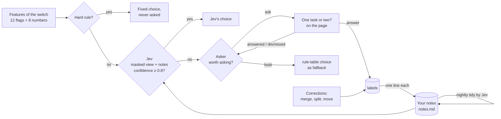

# Learning

Each switch between windows is one decision: same task, or a new one.



## 1. Features

Twelve yes-or-no signals, computed from the sessions before and after the switch.

| Signal | True when |
|---|---|
| `idle` | the gap is over 600 s |
| `case_conflict` | both sides carry case numbers and they differ |
| `shared_anchor` | both sides share a case number, a document, or a window |
| `same_surface` | the new session is a window already in the task, within 120 s |
| `copy_paste` | a copy on one side, a paste on the other, within 90 s |
| `search_then_create` | a web search, then a new document, within 90 s |
| `new_search` | a fresh search after document work, on a new subject |
| `context_saved` | the task so far saved or closed a document |
| `shared_words` | the two sides share enough rare words |
| `recent` | the gap is at most 90 s |
| `same_app` | the new session is in an app the task already used |
| `closed` | the previous session ended by closing its document |

Eight numbers: the gap in seconds, the previous session's length, the task's span so far, the strong and weak shared-word weights, the hour of day as sine and cosine, and whether the new session is a web page. Durations enter as `log(1 + seconds)`.

## 2. Hard rules

The first seven rows of the rule table are hard: they decide alone and are never sent to the model or asked.

| Rule | Choice | Confidence |
|---|---|---|
| idle | break | 1.00 |
| case_conflict | break | 1.00 |
| shared_anchor | same | 0.95 |
| same_surface | same | 0.90 |
| copy_paste | supporting | 0.85 |
| search_then_create | supporting | 0.85 |
| new_search and context_saved | break | 0.85 |

The remaining rows (`new_search`, `shared_words`, `closed`, `recent`, otherwise) give the choice when no answer from Jev applies: the call failed, Jev did not answer, or it answered below 0.8.

A label on a hard decision is counted against that rule. A rule is flagged when it has at least 50 labels and more than 20 % disagree with it. The flag shows in the status report and as a warning in `taskmine doctor`. Nothing changes on its own; a person reviews the rule.

## 3. Decision model

Jev by default. Any OpenAI-compatible model works.

- **What it sees.** For each switch: app names, cleaned titles, step kinds and seconds. Never saved text. The whole notes file goes with every request.
- **Batching.** The unsure switches of a settled pass go out in one request, with the match, verb and object questions of that pass.
- **Acting.** An answer applies at reported confidence 0.8 or more. Below that, the rule-table choice stands, the switch stays unsure, and Jev's confidence goes to the asker.
- **Failure.** A failed call or an answer that does not validate leaves the rule-table choice.
- **Calls.** At least 60 s between requests. There is no daily cap. When the day's calls pass `TASKMINE_MODEL_CALLS_ALERT` (default 120), the core raises one alert on stderr and in the status report, and calls go on.

Model answers are not labels. Only your answers, merges, splits and moves enter the notes.

## 4. Your notes

`~/.taskmine/notes.md`, mode 0600, made by the core. Markdown, one line per confirmed pattern, newest last. Each relation or match label adds a line in plain words:

```
- Preview to Excel is usually one task
- Twitter to YouTube is usually a new task
- Mail then Excel and Outlook then Excel are the same process
```

Lines hold app display names only. Titles, window text and task names never enter the file. Renames stay in the names table. Completion is a status and is not written.

**Nightly tidy.** Between 01:00 and 05:00 local, at least 20 h after the last tidy, and only when lines were added since. Jev rewrites the file: it merges duplicates, keeps the newest line where two disagree, and keeps the file under 200 lines. The reply replaces the file when it is non-empty and at most 200 lines; otherwise the newest 200 lines are kept. `taskmine tidy --force` runs it now.

## 5. Asker

Whether to ask you is a contextual bandit with Thompson sampling.

- **Context.** Three bits: is Jev's reported confidence within 0.10 of 0.8 (near) or not (far, also when Jev gave no answer); is it work hours; has this app pair been seen before. Eight contexts, each with a Beta(1, 1) prior over "will be answered".
- **Decision.** Sample the answer rate for the context. Ask when it is above 0.5, fewer than three questions are open, and ten minutes have passed since the last ask.
- **Reward.** Answered: +1 (alpha). Dismissed, or unanswered after 24 hours: +1 (beta). Later: no update, re-ask after 30 minutes.

## 6. Labels

Append-only. The current label for a decision is its newest row.

| You do | Label written |
|---|---|
| answer "one task" / "two tasks" | `same` / `break` on that decision |
| merge two tasks | `same` on every decision between them |
| split or move episodes | `break` between moved and remaining; `same` between moved and target |
| rename | the name for this step signature, reused for later tasks with the same signature |
| complete, reopen | recorded against the task's signature |

Relation and match labels are also written to the notes, one line each. A label on a hard decision is stored and counted, never applied.

## 7. Remembered, not learned

- A renamed task gives its name to every later task with the same step signature.
- A corrected task is locked. Later passes never regroup it.
- A confirmed process keeps its members and wins over automatic matching.
