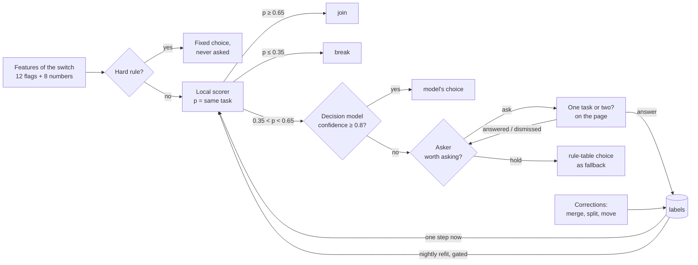

# Learning

Each switch between windows is one decision: same task, or a new one.

## 1. Features

Twelve yes-or-no signals, computed from the sessions before and after the switch.

| Signal | True when |
|---|---|
| `idle` | the gap is over 600 s |
| `case_conflict` | both sides carry case numbers and they differ |
| `shared_anchor` | both sides share a case number, a document, or a window |
| `same_surface` | the new session is a window already in the task, within 120 s |
| `copy_paste` | a copy on one side, a paste on the other, within 90 s |
| `search_then_create` | a web search, then a new document, within 90 s |
| `new_search` | a fresh search after document work, on a new subject |
| `context_saved` | the task so far saved or closed a document |
| `shared_words` | the two sides share enough rare words |
| `recent` | the gap is at most 90 s |
| `same_app` | the new session is in an app the task already used |
| `closed` | the previous session ended by closing its document |

Eight numbers: the gap in seconds, the previous session's length, the task's span so far, the strong and weak shared-word weights, the hour of day as sine and cosine, and whether the new session is a web page. Durations enter as `log(1 + seconds)`.

## 2. Hard rules

The first seven rows of the rule table are hard: they decide alone and are never sent to the model or asked.

| Rule | Choice | Confidence |
|---|---|---|
| idle | break | 1.00 |
| case_conflict | break | 1.00 |
| shared_anchor | same | 0.95 |
| same_surface | same | 0.90 |
| copy_paste | supporting | 0.85 |
| search_then_create | supporting | 0.85 |
| new_search and context_saved | break | 0.85 |

The remaining rows (`new_search`, `shared_words`, `closed`, `recent`, otherwise) are the fallback when the scorer is unsure.

## 3. Local scorer

A logistic regression over the twenty features, in pure Python. Output `p`, the probability that the task continues.

- **Starting weights.** Fitted on the 4096 signal combinations, with gaps sampled to match each, labelled by the rule table. Agreement with the table on soft combinations is at least 99 %.
- **Acting.** `p ≥ 0.65`: join (`same` in the same app, else `supporting`). `p ≤ 0.35`: break (`diversion` when the gap is under 90 s, so a short interruption can resume). Between: unsure.
- **Online step.** Each label is one step of stochastic gradient descent, learning rate 0.05.
- **Nightly refit.** Between 01:00 and 05:00, at least 20 hours after the last one, when new labels exist: refit on the whole label log. The new weights are kept only if they predict the newest 20 % of labels at least as well as the current weights. The last five versions are stored.

## 4. Decision model

Unsure switches of a settled pass go out in one request, with the match, verb and object questions of that pass. The model sees app names, cleaned titles, step kinds and seconds. An answer applies at confidence 0.8 or more. Model answers are not labels; the scorer learns from you only.

## 5. Asker

Whether to ask you is a contextual bandit with Thompson sampling.

- **Context.** Three bits: is `p` near 0.5 or far from it; is it work hours; has this app pair been seen before. Eight contexts, each with a Beta(1, 1) prior over "will be answered".
- **Decision.** Sample the answer rate for the context. Ask when it is above 0.5, fewer than three questions are open, and ten minutes have passed since the last ask.
- **Reward.** Answered: +1 (alpha). Dismissed, or unanswered after 24 hours: +1 (beta). Later: no update, re-ask after 30 minutes.

## 6. Labels

Append-only. The current label for a decision is its newest row.

| You do | Label written |
|---|---|
| answer "one task" / "two tasks" | `same` / `break` on that decision |
| merge two tasks | `same` on every decision between them |
| split or move episodes | `break` between moved and remaining; `same` between moved and target |
| rename | the name for this step signature, reused for later tasks with the same signature |
| complete, reopen | recorded against the task's signature |

A label on a hard decision is stored and counted, never applied.

## 7. Remembered, not learned

- A renamed task gives its name to every later task with the same step signature.
- A corrected task is locked. Later passes never regroup it.
- A confirmed process keeps its members and wins over automatic matching.
